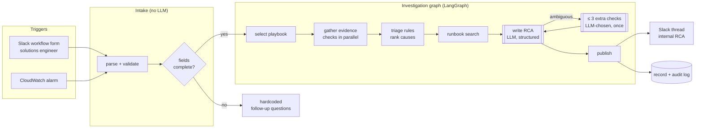

# incident-agent

An automated investigator for webhook delivery problems.

When a solutions engineer reports an issue through a Slack workflow form, or a CloudWatch alarm
fires, the agent gathers evidence from failed/DLQ events, service logs, metrics, deployments and
runbooks. It ranks the likely causes and posts an **internal root-cause analysis (RCA)** to the
Slack thread.

> **Status: MVP on mocked data (M2).** The whole pipeline runs end to end against realistic
> scenarios; real backends and the Slack app come later. Design and decisions: [PLAN.md](PLAN.md).

---

## Contents
- [How it works](#how-it-works)
- [Quick start](#quick-start)
- [Running it](#running-it)
- [Configuration](#configuration)
- [Repo tour](#repo-tour)
- [Mock scenarios](#mock-scenarios)
- [Extending it](#extending-it)
- [Safety and privacy](#safety-and-privacy)
- [Roadmap](#roadmap)

---

## How it works

**Code decides what to check; the LLM only writes up the evidence.** Intake, data gathering and
cause ranking are plain, tested Python. One LLM call turns the evidence into an RCA, and code
validates that RCA before it's published.



### The steps

| Step | LLM? | What happens |
|---|---|---|
| **Intake** | No | The Slack form or alarm becomes an `InvestigationRequest` (site, issue type, time window, event type/IDs). Missing or invalid fields get fixed follow-up questions instead of a guess. |
| **Playbook** | No | Each issue type (`not_received`, `failing`, `delayed`, `alarm`) maps to a fixed list of checks with concrete arguments. |
| **Gather** | No | Checks run in parallel through the same tool runner, with per-check timeouts, redaction and audit logging. A failed check becomes evidence of that and never stops the investigation. |
| **Triage** | No | 12 rules turn the evidence into ranked hypotheses, such as `MERCHANT_ENDPOINT_DOWN`, `NOT_SUBSCRIBED`, `DELIVERED_OK`, `BAD_DEPLOY` and `TRAFFIC_BURST`. Each hypothesis has a score, its reasons, and the checks that support it. |
| **Runbooks** | No | BM25 search over runbook sections for the top hypothesis. |
| **Write RCA** | **Yes** | One structured-output call. Code then checks that the category came from triage and that every cited source is a check that actually ran. If not, it asks the model once to fix it. |
| **Extra checks** | **Yes** | Only when the first draft finds the evidence ambiguous: the model may call up to 3 tools, once, and then the RCA is rewritten. |
| **Publish** | No | Writes the Slack message (MVP: to `outbox/`), the full investigation record and the audit log. |

**When the LLM fails:** overload, rate limits or timeouts switch to a fallback model. If that
fails too, an RCA built from triage alone is published and marked *needs manual review*. Every
trigger gets an answer.

### Tools

Playbooks, the extra-checks step and the debug chat all use the same tools. All of them are
read-only and return compact summaries.

| Tool | Returns |
|---|---|
| `get_webhook_config` | Site's endpoints (URL host only) and the event types each is subscribed to |
| `query_failed_events` | Failed/DLQ deliveries grouped by status, endpoint and event type; config-fetch failures counted separately |
| `lookup_events` | Current state of specific event IDs: retrying, DLQ or not found |
| `get_event_delivery_history` | Every delivery attempt for an event (time, status, `request_id`, time taken) and its outcome |
| `search_logs` | Service logs (Splunk or CloudWatch Logs): status mix, per-endpoint success rate and p50/p95 latency, then sample lines |
| `get_cloudwatch_metric` | Allowlisted metric: baseline, spikes, status against alarm thresholds, alarm history |
| `get_recent_deployments` | Deploys of the services with PR title/author and ECS rollout state |
| `search_runbooks` | Best-matching runbook sections with GitHub links |

---

## Quick start

**Prerequisites:** [uv](https://docs.astral.sh/uv/) (it installs Python 3.12 for you), and a
Gemini API key if you want LLM-written RCAs. The tests don't need a key.

```bash
uv sync
```

```bash
cp .env.example .env
```

Open `.env` and set `GOOGLE_API_KEY`. Then check that the configured models are available to
your key:

```bash
uv run incident-agent models
```

---

## Running it

### Investigate a trigger

```bash
uv run incident-agent investigate --trigger fixtures/triggers/bad_deploy.json
```

The terminal shows each check as it runs, the ranked causes, and the final RCA:

```
investigation b54755d0 · cloudwatch_alarm · webhook-delivery-failures-critical · alarm · window 13:55–16:00 UTC · scenario bad_deploy
  ▸ alarm_metric 3ms ✓ webhook.delivery_failures: max 679.16 failures / period (baseline 15.5) · critical · spike from 15:28
  ▸ lag_payment-events 3ms ✓ kafka.time_lag payment-events: max 263.96 seconds (baseline 2.06) · critical · spike from 15:31
  ▸ delivery_attempts 2ms ✓ webhook.delivery_attempts: max 1318.88 attempts / period (baseline 1213.67) · normal
  ▸ delivery_latency 2ms ✓ webhook.delivery_latency: max 10271.6 ms (baseline 365.6) · critical · spike from 15:28
  ▸ deployments 0ms ✓ 1 deploy(s); latest webhook-service PR #482 at 15:25
  ...
  ◆ BAD_DEPLOY score 0.85
  ▸ runbooks 2ms ✓ rollback-a-bad-deploy.md › Rolling back a bad webhook-service deploy · consumer-lag.md › Time lag rising
╭──────────────────────────── Automated RCA — internal ────────────────────────────╮
│ 🔎 Automated RCA — internal · webhook-delivery-failures-critical · alarm · confidence: high
│ ...
```

What gets written:

| Path | Contents |
|---|---|
| `outbox/<id>.md` | The message that would be posted to the Slack thread |
| `records/<id>.json` | The whole investigation: request, every check's data, hypotheses, RCA, model, timings |
| `logs/<id>.jsonl` | Audit log: every tool call and step |

All three directories are git-ignored. If the form is missing details, the follow-up questions go
to `outbox/questions-<id>.md` and no investigation runs:

```bash
uv run incident-agent investigate --trigger fixtures/triggers/missing_fields.json
```

The mock data comes from `fixtures/scenarios/<name>.yaml`, matched by the trigger's file name. Use
`--scenario <name>` to pick a different one.

### Debug chat

An interactive agent over the same tools and mock data, for poking at a scenario by hand:

```bash
uv run incident-agent chat --scenario merchant_down
```

Commands inside the chat: `/new`, `/scenario <name>`, `/tools`, `/trace`, `/retry`, `/help`, `/quit`.

### Tests

```bash
uv run pytest
```

The tests use mock data and a scripted LLM: no network and no API key. `tests/test_scenarios.py`
runs every scenario in [`evals/expectations.yaml`](evals/expectations.yaml) end to end and checks
that triage reaches the expected cause. CI runs the same tests on every pull request
(`.github/workflows/tests.yml`).

---

## Configuration

### Environment (`.env`, git-ignored)

| Variable | Default | Purpose |
|---|---|---|
| `GOOGLE_API_KEY` | — | Gemini API key (only needed for `investigate`, `chat` and `models`) |
| `LLM_PROVIDER` | `gemini` | Model provider; only Gemini is implemented so far |
| `GEMINI_MODEL` | `gemini-3.5-flash` | Main model, pinned (the `-latest` alias was often overloaded) |
| `GEMINI_FALLBACK_MODEL` | `gemini-3.1-flash-lite` | Used when the main model is overloaded, rate-limited or times out; empty disables it |
| `LLM_TIMEOUT_SECONDS` | `60` | Per LLM call |
| `LLM_MAX_RETRIES` | `2` | Total attempts per LLM call |
| `CHECK_TIMEOUT_SECONDS` | `20` | Per evidence check |
| `INCIDENTS_CHANNEL` | `#webhook-incidents` | Where alarm-triggered RCAs go |
| `MOCK_SCENARIO` | `merchant_down` | Default scenario for `chat` |

### Static config (`config/`, committed)

| File | Contents |
|---|---|
| `metrics.yaml` | CloudWatch metric allowlist: namespace, name, dimensions, alarm thresholds, spike sensitivity |
| `logs.yaml` | Logical log sources and their Splunk index / CloudWatch log group |
| `topic_mapping.yaml` | Event type → Kafka topic → consumer group (mirrors the producer) |
| `sites.yaml` | Known site IDs for intake validation (the internal API in production) |

Names marked `# assumed` in these files are placeholders until the real ones are confirmed.

---

## Repo tour

```
incident-agent/
├── PLAN.md                     design, decisions, milestones, production prerequisites
├── config/                     allowlists and mappings (see Configuration)
├── src/incident_agent/
│   ├── settings.py             environment settings (.env)
│   ├── config.py               loaders for config/
│   ├── llm.py                  model factory, fallback, transient-error handling
│   ├── redact.py               strips secrets from anything shown to the LLM or logged
│   ├── audit.py                JSONL audit log
│   │
│   ├── intake/                 trigger → InvestigationRequest (no LLM)
│   │   ├── slack_form.py         form fields, validation, time window rules
│   │   ├── alarm.py              CloudWatch alarm (SNS) messages
│   │   ├── questions.py          the fixed follow-up questions
│   │   └── models.py             InvestigationRequest, IntakeResult
│   │
│   ├── investigation/          the trigger-driven workflow
│   │   ├── graph.py              LangGraph wiring of the steps below
│   │   ├── playbooks.py          which checks run for which trigger
│   │   ├── gather.py             runs checks in parallel with timeouts
│   │   ├── triage.py             the 12 rules that rank causes
│   │   ├── rca.py                RCA schema, LLM call, validation, deterministic fallback
│   │   ├── extra_checks.py       optional round of LLM-chosen checks
│   │   ├── prompts.py            RCA and extra-check prompts
│   │   ├── publish.py            Slack message, outbox and record files
│   │   └── models.py             Check, Evidence, Hypothesis, Category
│   │
│   ├── tools/                  what playbooks and the LLM can call (schemas, guardrails, summaries)
│   │   ├── runner.py             shared execution: timing, errors, audit
│   │   └── <one module per tool>
│   │
│   ├── backends/               data access only, behind interfaces
│   │   ├── base.py               Protocols each backend implements
│   │   └── mock/                 scenario-driven fakes and trigger loading
│   │
│   ├── chat/                   the debug chat agent (graph + prompt)
│   └── apps/cli/               entry points: investigate, chat, models
│
├── fixtures/
│   ├── scenarios/              mock data per scenario, layered on _base.yaml
│   ├── triggers/               Slack form and alarm payloads, one per scenario
│   └── runbooks/               sample runbooks (docs/*.md per service repo)
├── evals/                      expected outcome per scenario (agent quality, not code correctness)
├── tests/                      unit and end-to-end tests (scripted LLM)
└── .github/workflows/          CI: uv sync + pytest on pull requests
```

**Where to start reading:** `investigation/graph.py` for the flow, then `playbooks.py` →
`triage.py` → `rca.py`.

---

## Mock scenarios

Each scenario is a YAML file describing an incident *on top of* a healthy platform
(`_base.yaml`). It uses groups like "380 × 503 on wg_3532 over the last 95 minutes" rather than
literal rows, and times relative to now, so data always looks current and is reproducible.

| Scenario | Trigger | What's going on | Expected cause |
|---|---|---|---|
| `merchant_down` | Slack form, failing | One endpoint returns 503/504, the rest of the platform is healthy | `MERCHANT_ENDPOINT_DOWN` |
| `not_subscribed` | Slack form, not received | Endpoint isn't subscribed to `invoice.paid` | `NOT_SUBSCRIBED` |
| `delivered_ok` | Slack form + event ID | First attempt 503, retry got 200 | `DELIVERED_OK` |
| `still_retrying` | Slack form + event ID | 3 failed attempts, more retries pending | `STILL_RETRYING` |
| `not_consumed` | Slack form + event ID | Published, but the consumer is lagging | `NOT_CONSUMED` |
| `bad_deploy` | Alarm: delivery failures | webhook-service deploy, then failures everywhere | `BAD_DEPLOY` |
| `config_api_auth` | Slack form, not received | Key rotation deploy, then config fetch 401s | `CONFIG_FETCH_FAILURE` |
| `traffic_burst` | Alarm: offset lag | Big batch; offset lag high, time lag low | `TRAFFIC_BURST` |
| `rate_limited` | Slack form, delayed | Endpoint answers 429; rate-limit topic backs up | `MERCHANT_RATE_LIMITING` |
| `missing_fields` | Slack form, incomplete | No site or start time | Follow-up questions, no investigation |

---

## Extending it

**A new failure category:**
1. Add it to `Category` in `investigation/models.py` and a runbook query in `playbooks.py`.
2. Write the rule in `triage.py` and add it to `RULES`.
3. Add a scenario (`fixtures/scenarios/`), a trigger (`fixtures/triggers/`) and an entry in
   `evals/expectations.yaml`. `tests/test_scenarios.py` picks it up automatically.

**A new tool:**
1. Add a backend method to `backends/base.py` and a mock in `backends/mock/`.
2. Write the tool in `tools/`: a Pydantic input, a compact summary, errors returned as data.
3. Register it in `tools/__init__.py`, and reference it from a playbook if it should run
   automatically.

**A real backend** (AWS, Splunk, GitHub): implement the matching Protocol in `backends/base.py`.
Tools and the investigation don't change.

---

## Safety and privacy

- **Read-only:** no tool can change anything. Replays and rollbacks are suggestions for people to carry out.
- **Internal only:** RCAs go to internal Slack threads, never to Jira or customers.
- **No payloads to the LLM:** only the event type is read from event payloads. Secrets and URL
  tokens are stripped from all tool output and logs.
- **Untrusted text stays data:** the engineer's free-text description is passed as a labeled
  field, and the model is told to ignore any instructions in it.
- **Mock data only with Gemini:** before real data, switch to a provider approved for production
  data (see [PLAN.md §16](PLAN.md)).

---

## Roadmap

| Milestone | |
|---|---|
| M0–M2 ✅ | Chat prototype → trigger pipeline → all tools, rules and scenarios on mock data |
| M3 | Eval runner with the real model, dedupe, investigation time limits |
| M4 | Slack app and alarm subscription in a test workspace; real backends in staging |
| M5 | Production LLM and rollout |

Details and production prerequisites (IAM, DynamoDB indexes, network, tokens) are in [PLAN.md](PLAN.md).
